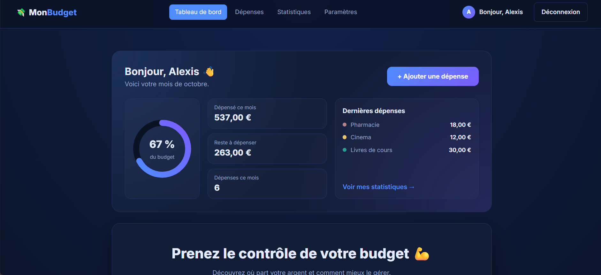
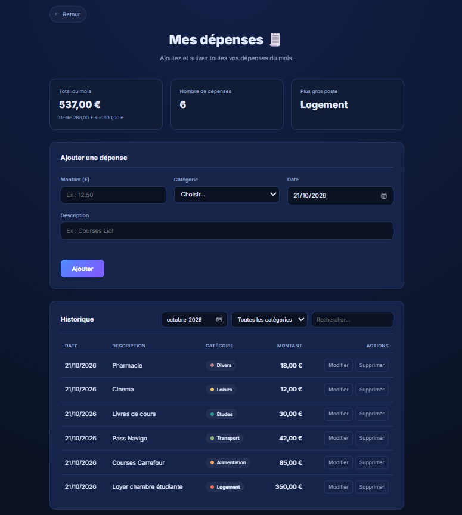
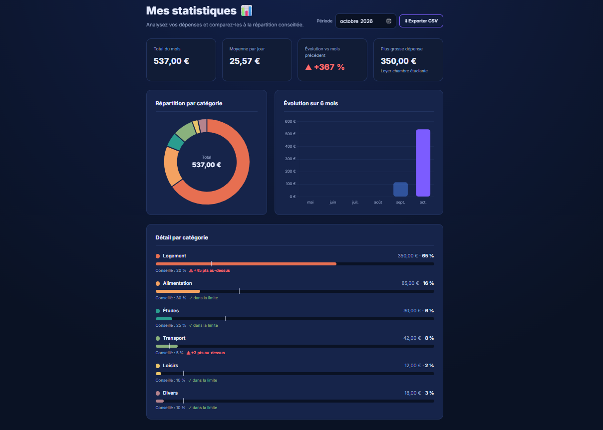
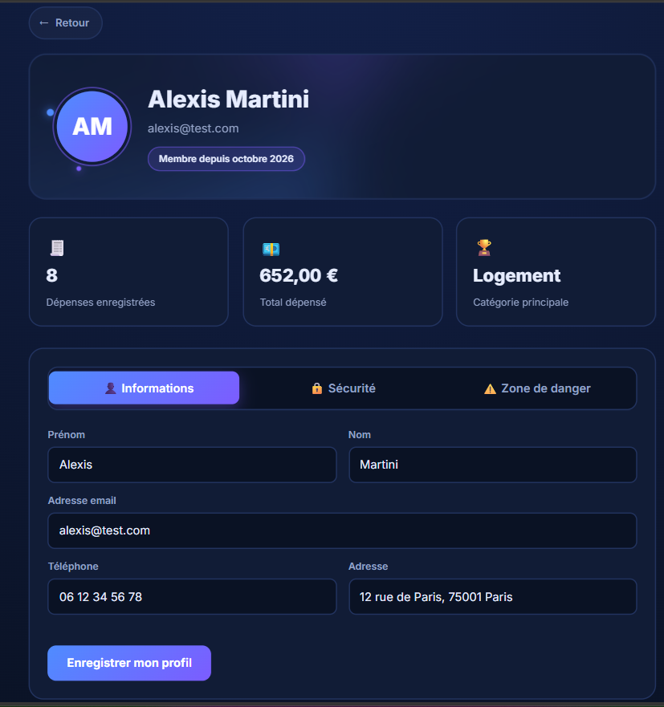

# 💸 MonBudget

**Application web de suivi de budget pour étudiants** : notez vos dépenses, visualisez votre mois et gardez le contrôle de votre budget.


---

## 📸 Aperçu

| Tableau de bord | Dépenses |
|---|---|
|  |  |

| Statistiques | Profil |
|---|---|
|  |  |

---

## ✨ Fonctionnalités

### Comptes et sécurité
- **Inscription** avec vérification en direct de la force du mot de passe
- **Connexion** avec « Se souvenir de moi » et retour automatique à la page demandée
- **Profil** : modifier ses informations, changer de mot de passe, supprimer son compte
- Pages réservées aux utilisateurs connectés (🔒 dans le menu quand on est déconnecté)
- Confirmation avant la déconnexion

### Gestion du budget
- **Tableau de bord** personnalisé : résumé du mois, anneau de progression du budget, dernières dépenses
- **Dépenses** : ajout, modification, suppression, filtres par mois et catégorie, recherche
- **Statistiques** : indicateurs clés, graphique par catégorie, évolution sur 6 mois, comparaison avec la répartition conseillée, export CSV
- **Paramètres** : budget mensuel, répartition conseillée, couleurs des catégories, animations, export / import / effacement des données

### Autres pages
- **Contact** : formulaire relié à [Formspree](https://formspree.io), avec protection anti-robots
- **Conditions d'utilisation** avec sommaire interactif
- Pied de page et bouton « ← Retour » sur toutes les pages

### Expérience utilisateur
- Thème sombre « bleu nuit » et animations différentes sur chaque page
- Design **responsive** (ordinateur, tablette, téléphone)
- Respect du réglage système « réduire les animations », et interrupteur dans les Paramètres

---

## 🛠️ Technologies

| Côté | Technologies |
|---|---|
| **Interface** | HTML5, CSS3 (variables, Grid, Flexbox, animations), JavaScript (sans framework) |
| **Graphiques** | [Chart.js](https://www.chartjs.org) |
| **Serveur** | PHP 8 (API JSON, sessions, PDO) |
| **Base de données** | MySQL 8 |
| **Formulaire de contact** | Formspree |
| **Outils** | VS Code, WAMP, phpMyAdmin, Git, GitHub |

---

## 📁 Structure du projet

```
mon-budget/
├── api/                 API PHP (renvoie du JSON)
│   ├── bootstrap.php    outils communs : session, réponses, erreurs
│   ├── db.php           connexion à la base (PDO)
│   ├── register.php     inscription
│   ├── login.php        connexion
│   ├── logout.php       déconnexion
│   ├── me.php           utilisateur connecté
│   ├── account.php      infos + statistiques du compte, suppression
│   ├── profile.php      modification du profil
│   ├── password.php     changement de mot de passe
│   ├── expenses.php     dépenses (lire, ajouter, modifier, supprimer)
│   ├── settings.php     paramètres de l'utilisateur
│   └── data.php         import et effacement des données
├── css/
│   └── style.css
├── js/
│   ├── settings.js      paramètres partagés par toutes les pages
│   ├── auth.js          comptes, menu, bouton Retour, pied de page
│   ├── accueil.js       tableau de bord
│   ├── depenses.js
│   ├── stats.js
│   ├── parametres.js
│   ├── profil.js
│   ├── connexion.js
│   ├── inscription.js
│   ├── contact.js
│   └── conditions.js
├── sql/
│   └── schema.sql       création de la base et des tables
├── index.html           tableau de bord
├── depenses.html
├── stats.html
├── parametres.html
├── profil.html
├── connexion.html
├── inscription.html
├── contact.html
└── conditions.html
```

---

## 🗄️ Base de données

| Table | Contenu |
|---|---|
| `users` | comptes : prénom, nom, email (unique), téléphone, adresse, empreinte du mot de passe |
| `expenses` | dépenses, chacune reliée à son utilisateur |
| `settings` | paramètres de chaque utilisateur (en JSON) |

Les dépenses et paramètres sont supprimés automatiquement avec le compte (`ON DELETE CASCADE`).

---

## 🔌 API

| Méthode | Adresse | Rôle |
|---|---|---|
| `POST` | `api/register.php` | créer un compte |
| `POST` | `api/login.php` | se connecter |
| `POST` | `api/logout.php` | se déconnecter |
| `GET` | `api/me.php` | utilisateur connecté |
| `GET` / `DELETE` | `api/account.php` | infos et statistiques du compte / supprimer le compte |
| `PUT` | `api/profile.php` | modifier le profil |
| `PUT` | `api/password.php` | changer de mot de passe |
| `GET` / `POST` / `PUT` / `DELETE` | `api/expenses.php` | lire / ajouter / modifier / supprimer une dépense |
| `GET` / `PUT` | `api/settings.php` | lire / enregistrer les paramètres |
| `POST` / `DELETE` | `api/data.php` | importer une sauvegarde / effacer toutes ses dépenses |

---

## 🚀 Installation en local

### Prérequis
- [WAMP](https://www.wampserver.com) (ou XAMPP / Laragon), avec **PHP 8** et **MySQL 8**
- PHP accessible dans le terminal : la commande `php -v` doit fonctionner

### Étapes

**1. Cloner le projet**
```bash
git clone https://github.com/r-ovoundard/mon-budget.git
cd mon-budget
```

**2. Créer la base de données**
Démarrez WAMP, ouvrez [phpMyAdmin](http://localhost/phpmyadmin), onglet **SQL**, puis exécutez le contenu de `sql/schema.sql`.

**3. Vérifier la connexion**
Les identifiants de la base sont dans `api/db.php` (par défaut : utilisateur `root`, sans mot de passe, comme dans WAMP).

**4. Configurer le formulaire de contact** *(facultatif)*
Créez un formulaire gratuit sur [Formspree](https://formspree.io), puis remplacez l'adresse `FORMSPREE_URL` dans `js/contact.js`.

**5. Lancer le serveur**
```bash
php -S localhost:8000
```

**6. Ouvrir l'application**
👉 [http://localhost:8000/index.html](http://localhost:8000/index.html)

---

## 🔐 Sécurité

- Mots de passe **jamais enregistrés en clair** : empreinte avec `password_hash()` (bcrypt)
- **Requêtes préparées** (PDO) contre les injections SQL
- Toutes les données sont **revérifiées côté serveur**
- Chaque utilisateur n'accède **qu'à ses propres données** (identifiant pris dans la session, jamais envoyé par le navigateur)
- Cookie de session `HttpOnly` et `SameSite`, identifiant renouvelé à la connexion
- Ancien mot de passe obligatoire pour changer de mot de passe ou supprimer son compte
- Textes saisis par les utilisateurs affichés sans être interprétés comme du HTML (protection XSS)

---

## 🗺️ Versions

| Version | Contenu |
|---|---|
| **v1.0** | application 100 % JavaScript, données dans le navigateur (`localStorage`) |
| **v2.0** | serveur PHP + base MySQL, comptes, données par utilisateur, profil, contact |

---

## 🔭 Pour aller plus loin

- Réinitialisation du mot de passe par email (lien sécurisé à usage unique)
- Menu « burger » sur téléphone
- Mise en ligne chez un hébergeur PHP / MySQL
- Pour une mise en production : HTTPS, limitation des tentatives de connexion, utilisateur MySQL dédié et identifiants hors du dépôt

---

## 👤 Auteur

**Nissi Rich OVOUNDARD** – développeur full stack en formation
GitHub : [@r-ovoundard](https://github.com/r-ovoundard)

> Projet personnel réalisé pendant ma formation, pour pratiquer le développement web de A à Z : interface, animations, API PHP et base de données.